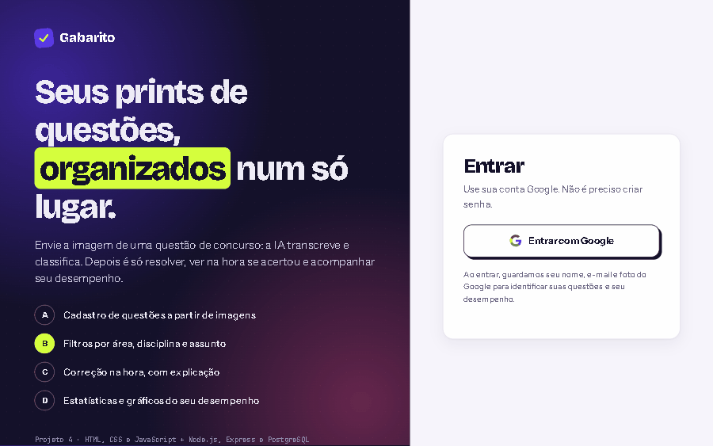

# Projeto: Gabarito, banco de questões para concursos com autenticação, IA e plano PRO



## Acesso

**https://gabarito-wuap.onrender.com**

> O plano gratuito do Render "dorme" após 15 minutos sem acesso: o primeiro carregamento pode levar
> cerca de 1 minuto.

## Desenvolvedor(a)

Carlos Henrique Mendina Gonçalves Pereira — Engenharia de Computação

## Proposta

Plataforma web para gerenciar, armazenar e resolver questões de concursos públicos. O usuário entra com a
conta Google e envia prints de questões encontradas na internet. Uma IA com visão computacional transcreve o
enunciado e as alternativas, identifica o gabarito **quando ele aparece na imagem** (sem inventar) e
classifica a questão por área, disciplina, assunto e subassunto. Antes de salvar, o usuário revisa e corrige
tudo num formulário.

As questões podem ser filtradas, pesquisadas e resolvidas, com correção feita pelo servidor. A IA também tira
dúvidas sobre cada questão e analisa o desempenho do usuário a partir dos dados reais do banco. Há dois níveis
de acesso: **gratuito**, com as próprias questões, e **PRO**, que também acessa o banco de questões
compartilhadas por todos os usuários. O controle de acesso é feito no backend.

Frontend em HTML, CSS e JavaScript puro, como nos projetos anteriores. Backend em Node.js + Express com
PostgreSQL, publicado no Render, reaproveitando a estrutura do Projeto 3.

### O que foi entregue

| Funcionalidade | Acesso |
|---|---|
| Tela de login com Google | qualquer pessoa |
| Início: resumo do desempenho e atalhos | **somente autenticado** |
| Adicionar questão por imagem (IA) ou manualmente, com revisão antes de salvar | **somente autenticado** |
| Minhas questões: editar e excluir | **somente autenticado, só as próprias** |
| Banco de questões: filtros (área, disciplina, assunto), pesquisa e resolução com correção | **autenticado**: as próprias + as compartilhadas, se for PRO |
| Perguntar à IA sobre uma questão | **autenticado**, só nas questões que ele pode ver |
| Desempenho: totais, acertos por disciplina, evolução, histórico e análise com IA | **somente autenticado, só os próprios dados** |
| Banco compartilhado: resolver questões cadastradas por outras pessoas | **somente PRO** |
| Assinar PRO ou voltar ao gratuito (demonstração, sem cobrança) | **somente autenticado** |

## Desenvolvimento

### Processo

> ✍️ **A escrever pelo desenvolvedor.** Pelo template da disciplina, esta seção deve ser escrita em primeira
> pessoa, sem ajuda de IA.

### Trechos de código

**1. Rota pública: o começo do login com Google** ([auth.js](./auth.js))

Não existe cadastro com senha: quem confere a identidade é o Google. A rota `/auth/google` é pública e só
manda o navegador para a página de login do Google. O detalhe importante é o `state`: um valor aleatório
guardado num cookie e enviado junto. Na volta, o servidor confere se é o mesmo. Isso impede que outro site
"injete" um login falso.

```js
router.get('/auth/google', (req, res) => {
  if (!isGoogleConfigured()) {
    return res.redirect('/?erro=google-nao-configurado');
  }

  const state = crypto.randomBytes(16).toString('hex');
  res.cookie(STATE_COOKIE, state, { ...cookieOptions, maxAge: 10 * 60 * 1000 }); // vale 10 minutos

  const params = new URLSearchParams({
    client_id: process.env.GOOGLE_CLIENT_ID,
    redirect_uri: REDIRECT_URI,
    response_type: 'code',
    scope: 'openid email profile',   // pedimos só nome, e-mail e foto
    state,
    prompt: 'select_account',        // sempre deixa escolher qual conta usar
  });
  res.redirect(`https://accounts.google.com/o/oauth2/v2/auth?${params}`);
});
```

**2. O retorno do Google: criar o usuário e entregar o "crachá" (JWT) num cookie** ([auth.js](./auth.js))

O Google devolve o navegador para `/auth/google/callback` com um `code` de uso único. O servidor troca esse
`code` pelos dados do perfil numa conversa direta com o Google, usando o `GOOGLE_CLIENT_SECRET`, que nunca vai
para o navegador. Depois, cria ou atualiza o usuário e grava o crachá:

```js
// "Upsert": cria o usuário na 1ª vez; nas próximas, só atualiza nome, e-mail e foto.
const result = await pool.query(
  `INSERT INTO users (google_id, name, email, picture_url)
   VALUES ($1, $2, $3, $4)
   ON CONFLICT (google_id) DO UPDATE
     SET name = EXCLUDED.name, email = EXCLUDED.email, picture_url = EXCLUDED.picture_url
   RETURNING id`,
  [profile.sub, profile.name || profile.email, profile.email, profile.picture || null]
);

// O crachá guarda só o id. O plano NÃO vai no crachá: ele é lido do banco a cada pedido.
const sessionToken = jwt.sign({ id: result.rows[0].id }, process.env.JWT_SECRET, { expiresIn: '7d' });
res.cookie(SESSION_COOKIE, sessionToken, { ...cookieOptions, maxAge: SEVEN_DAYS_MS });
res.redirect('/dashboard.html');
```

```js
const cookieOptions = {
  httpOnly: true,                       // o JavaScript da página NÃO consegue ler o cookie
  sameSite: 'lax',                      // não vai em POSTs vindos de outros sites (CSRF)
  secure: APP_URL.startsWith('https'),  // no Render (https), só trafega criptografado
};
```

Diferença para o Projeto 3: lá o token ficava no `localStorage` e ia no cabeçalho `Authorization`. Aqui isso
não funcionaria, porque depois do login o Google redireciona o navegador direto para o servidor e não existe
um `fetch` onde o JavaScript possa receber o token. O servidor grava o cookie nesse redirecionamento, e o
navegador o envia sozinho em todo pedido. Como o cookie é `httpOnly`, nenhum script consegue roubá-lo.

**3. Rota protegida: o "porteiro" `requireAuth`** ([auth.js](./auth.js))

Roda antes de toda rota da API. Sem crachá válido, responde **401** e a rota nem executa. Com crachá válido,
busca o usuário **no banco** e coloca em `req.user`:

```js
async function requireAuth(req, res, next) {
  const token = req.cookies[SESSION_COOKIE];
  if (!token) {
    return res.status(401).json({ error: 'Faça login para acessar' });
  }

  let payload;
  try {
    payload = jwt.verify(token, process.env.JWT_SECRET);
  } catch (error) {
    return res.status(401).json({ error: 'Sessão inválida ou expirada. Faça login de novo' });
  }

  const result = await pool.query(
    'SELECT id, name, email, picture_url, plan, created_at FROM users WHERE id = $1',
    [payload.id]
  );
  if (!result.rows[0]) {
    return res.status(401).json({ error: 'Usuário não encontrado. Faça login de novo' });
  }
  req.user = result.rows[0];
  next();
}
```

Buscar no banco a cada pedido é o que garante que o **plano (free/pro) é sempre o atual** e que ninguém
consegue "se promover" alterando algo no navegador.

**4. Autorização: a regra do PRO dentro do SQL** ([routes/questions.js](./routes/questions.js))

A regra mais importante do sistema é uma constante que entra no `WHERE` de **toda** consulta que lê questões:

```js
// O usuário vê a questão se for o AUTOR, ou se ela for COMPARTILHADA e ele for PRO.
// $1 = id do usuário e $2 = plano do usuário (os dois vêm de req.user).
const CAN_SEE = `(q.author_id = $1 OR (q.is_shared AND $2 = 'pro'))`;
```

```js
router.get('/questions/:id', requireAuth, async (req, res) => {
  // ...
  const result = await pool.query(
    `SELECT q.id, q.statement, /* ... */ (q.correct_letter IS NOT NULL) AS has_answer_key
     FROM questions q JOIN users u ON u.id = q.author_id
     WHERE q.id = $3 AND ${CAN_SEE}`,
    [req.user.id, req.user.plan, id]
  );
  const question = result.rows[0];
  if (!question) return res.status(404).json({ error: 'Questão não encontrada' });
```

- Se um usuário gratuito pede uma questão compartilhada pelo id, a consulta não devolve nada e ele recebe
  **404**: a mesma resposta de "não existe", para ninguém descobrir questões alheias testando números.
- Se ele pede a lista `?scope=shared`, recebe **403**. A tela não esconde essa aba: ela mostra
  *"Acesso negado pelo servidor · HTTP 403"*, deixando claro que quem bloqueia é o backend.
- Editar e apagar usam `WHERE id = $1 AND author_id = $2`: só o autor consegue.
- Repare que o gabarito **não** está no `SELECT`. Ele só é enviado depois que o usuário responde
  (`POST /answer`), e é o servidor que corrige.

**5. Curiosidade: a IA não pode inventar o gabarito** ([ai.js](./ai.js))

A IA é obrigada a responder num JSON com formato fixo (*saída estruturada*), e as instruções proíbem que ela
resolva a questão:

```
3. correct_letter: preencha SOMENTE se a imagem mostrar o gabarito (ex.: "Gabarito: C", alternativa marcada
   como correta, resposta destacada). Se não houver gabarito visível, use "" (vazio). NUNCA resolva a questão
   nem deduza a resposta.
```

No teste com uma questão de porcentagem sem gabarito no print, a IA deixou o campo vazio, mesmo sendo uma
conta fácil. Outro detalhe aprendido: o modelo principal do plano gratuito (`gemini-3.8-flash`) respondeu
"sobrecarregado" (HTTP 503) várias vezes, e em horário de pico **todos** os modelos gratuitos recusaram ou
demoraram quase 1 minuto. Por isso o servidor usa **três serviços gratuitos** em sequência (Groq, OpenRouter e Gemini): se um estiver
sobrecarregado, sem cota ou demorar mais de 60 s, tenta o próximo, por no máximo 2 minutos, e avisa o
usuário se nenhum responder.

## Tecnologias

### Linguagens e afins

- JavaScript no frontend e no backend (Node.js, CommonJS)
- HTML5 e CSS3 puros, sem frameworks; gráficos feitos só com CSS; janela de confirmação com `<dialog>`
- Node.js (20+) + **Express 5** (servidor web e API REST; erros de rotas `async` chegam sozinhos ao tratador de erros)
- **PostgreSQL 16** com a biblioteca `pg` (SQL escrito à mão, sem ORM)
  - chaves estrangeiras com `on delete cascade`, `unique`, `check` e índices
  - transação (`BEGIN`/`COMMIT`/`ROLLBACK`) para salvar a questão e as alternativas juntas
  - `count(*) FILTER (WHERE ...)`, `to_char(... AT TIME ZONE 'America/Sao_Paulo')` e `ILIKE` para estatísticas e pesquisa
  - o servidor roda o `db/schema.sql` ao ligar (`create table if not exists`), então as tabelas nascem sozinhas no Render
- **Google OAuth 2.0** (fluxo *authorization code*), escrito com o `fetch` do Node, sem biblioteca de login
- `jsonwebtoken` (crachá JWT) + `cookie-parser` (ler o cookie) + `dotenv` (variáveis de ambiente)
- **IAs gratuitas com troca automática**, todas com `fetch` puro: **Groq** e **OpenRouter** (formato do OpenAI, modo JSON) e **Google Gemini** (Interactions API, saída estruturada). Usadas para ler imagens, tirar dúvidas e analisar o desempenho
- Canvas do navegador para reduzir a imagem antes do envio (fotos de celular podem passar de 10 MB); a imagem **não é guardada**, só o texto extraído
- Docker + Docker Compose (PostgreSQL local para desenvolvimento)
- Render: Web Service (Node) + PostgreSQL, configurados manualmente pelo painel (sem blueprints)
- `node:test` (20 testes automáticos da API, sem dependências extras)

### Autenticação e autorização

- **Autenticação por token (JWT), sem sessão no servidor.** O login é feito com o Google (OAuth 2.0). Depois
  dele, o servidor entrega um JWT assinado com o `JWT_SECRET`, contendo só o `id` do usuário e com validade
  de 7 dias, num **cookie `httpOnly`, `sameSite=lax`** (e `secure` em https). O navegador envia o cookie
  sozinho em todo pedido.
- **Sem senha, sem hash:** o projeto não guarda senhas. Quem confere a senha é o Google. O `client_secret`
  do Google fica só no servidor, e o parâmetro `state` protege o retorno do login.
- **Cadastro:** acontece no primeiro login. O "upsert" pelo `google_id` cria o usuário ou atualiza nome, e-mail e foto.
- **Logout:** `POST /auth/logout` apaga o cookie.
- **Autenticação no backend:** o middleware `requireAuth` está em toda rota da API, exceto `/api/health`.
  Responde 401 se o crachá faltar, estiver alterado ou expirado, ou se o usuário não existir mais.
- **Autorização no backend:**
  - o id do usuário vem sempre do crachá e o **plano vem do banco** a cada pedido, nunca do navegador;
  - a regra `CAN_SEE` (autor **ou** compartilhada + PRO) entra no SQL de toda leitura de questões;
  - editar e apagar só pelo autor (`AND author_id = ...`; questão de outro → 404);
  - banco compartilhado para gratuitos → 403; o gabarito só depois de responder; a correção é feita no servidor;
  - estatísticas e análise usam só `WHERE user_id = req.user.id`;
  - a **assinatura PRO é demonstrativa**: `PUT /api/me/plan` muda o plano do próprio usuário logado, sem
    pagamento. Numa versão real, essa rota daria lugar à confirmação de um serviço de pagamento.
- **Testes de acesso:** [tests/api.test.js](./tests/api.test.js) tem **20 testes** de acessos permitidos e
  **não permitidos**: sem login, crachá falsificado, usuário gratuito tentando ver, responder ou perguntar
  sobre questão compartilhada, PRO tentando ver questão particular de outro, edição e exclusão por quem não
  é autor, correção pelo servidor, troca de plano e estatísticas. Como o login real é pelo Google, os testes
  criam usuários temporários no banco e assinam o crachá com o mesmo `JWT_SECRET` (e apagam tudo no final).
  - local (servidor ligado): `npm test`
  - contra o site publicado: veja [docs/GUIA.md → Testes contra o Render](./docs/GUIA.md#rodar-os-testes-contra-o-site-publicado)

| Rota | Acesso |
|---|---|
| `GET /auth/google`, `GET /auth/google/callback`, `POST /auth/logout`, `GET /api/health` | pública |
| `GET /api/me`, `PUT /api/me/plan` | autenticado |
| `POST /api/questions/extract`, `POST /api/questions` | autenticado |
| `GET /api/questions`, `GET /api/questions/filters`, `GET /api/questions/:id` | autenticado + regra `CAN_SEE` (`?scope=shared` só PRO → 403) |
| `POST /api/questions/:id/answer`, `GET`/`POST /api/questions/:id/doubts` | autenticado + regra `CAN_SEE` |
| `PUT /api/questions/:id`, `DELETE /api/questions/:id`, `GET /api/me/questions(/:id)` | autenticado + autor |
| `GET /api/stats`, `GET`/`POST /api/stats/analysis` | autenticado (só os próprios dados) |

### Como rodar localmente

```powershell
docker compose up -d     # PostgreSQL local (container questoes-postgres, porta 5434)
copy .env.example .env   # e preencha: JWT_SECRET, credenciais do Google e chaves das IAs (Groq/OpenRouter/Gemini)
npm install
npm start                # http://localhost:3002 (as tabelas são criadas ao ligar)
npm run db:exemplos -- seu@email.com   # 20 questões de exemplo (depois do 1º login com o Google)
npm test                 # (em outro terminal) testes de acesso da API
npm run test:ia          # confere se a chave do Gemini funciona
```

O passo a passo completo (credenciais do Google, chave do Gemini, publicação no Render, estrutura de pastas,
banco de dados e problemas comuns) está em **[docs/GUIA.md](./docs/GUIA.md)**.

### Ambiente de desenvolvimento

- VS Code (Windows 10)
- Claude Code (extensão do VS Code, modelo Claude Opus 5.5): agente de IA que analisou o Projeto 3, propôs o
  plano de etapas e, a meu pedido, implementou o código, os testes, a documentação técnica e o GIF
- Docker Desktop (PostgreSQL 16)
- Node.js 26 / npm
- Git e GitHub
- Google Cloud Console (credenciais OAuth), Google AI Studio (chave do Gemini), Groq Console e OpenRouter (chaves das outras IAs gratuitas)
- Render (painel web)
- Google Chrome em modo headless (testes automatizados da interface e gravação do GIF)

## Referências e créditos

- [Documentação do Express](https://expressjs.com/pt-br/)
- [node-postgres (`pg`)](https://node-postgres.com/): pool, consultas parametrizadas, transações e conversão de tipos
- [Documentação do PostgreSQL 16](https://www.postgresql.org/docs/16/): `FILTER`, `to_char`, `AT TIME ZONE`, `ILIKE`, `ON CONFLICT`
- [Google Identity: OAuth 2.0 para aplicativos de servidor web](https://developers.google.com/identity/protocols/oauth2/web-server) e [OpenID Connect](https://developers.google.com/identity/openid-connect/openid-connect)
- [Gemini API](https://ai.google.dev/gemini-api/docs): Interactions API, saída estruturada, entendimento de imagens, preços e limites do plano gratuito
- [Groq: visão e limites do plano gratuito](https://console.groq.com/docs/vision) e [OpenRouter: limites dos modelos gratuitos](https://openrouter.ai/docs/api-reference/limits)
- [jsonwebtoken](https://github.com/auth0/node-jsonwebtoken) e [cookie-parser](https://github.com/expressjs/cookie-parser)
- MDN: [Cookies HTTP (`HttpOnly`, `SameSite`)](https://developer.mozilla.org/pt-BR/docs/Web/HTTP/Cookies), [`<dialog>`](https://developer.mozilla.org/pt-BR/docs/Web/HTML/Element/dialog), [`canvas.toDataURL`](https://developer.mozilla.org/pt-BR/docs/Web/API/HTMLCanvasElement/toDataURL), [Fetch API](https://developer.mozilla.org/pt-BR/docs/Web/API/Fetch_API)
- [OWASP: prevenção de XSS](https://cheatsheetseries.owasp.org/cheatsheets/Cross_Site_Scripting_Prevention_Cheat_Sheet.html)
- [Render Docs](https://render.com/docs): Web Services, PostgreSQL e variáveis de ambiente
- [Docker Hub: imagem oficial do Postgres](https://hub.docker.com/_/postgres)
- [Node.js: test runner (`node:test`)](https://nodejs.org/api/test.html)
- [Google Fonts](https://fonts.google.com/): Inter e Source Serif 4
- [Projeto 3 (Dino Game)](https://github.com/elc1090/project3-2026b-cau19): base para a estrutura do servidor, do banco, dos testes e do deploy
- GIF gravado com Chrome headless + `gif-encoder-2` e `pngjs` (usados só numa pasta temporária, fora do projeto)
- Claude Code (Anthropic): assistente de IA, conforme descrito em "Ambiente de desenvolvimento"

---
Projeto entregue para a disciplina de [Desenvolvimento de Software para a Web](http://github.com/andreainfufsm/elc1090-2026b) em 2026b
